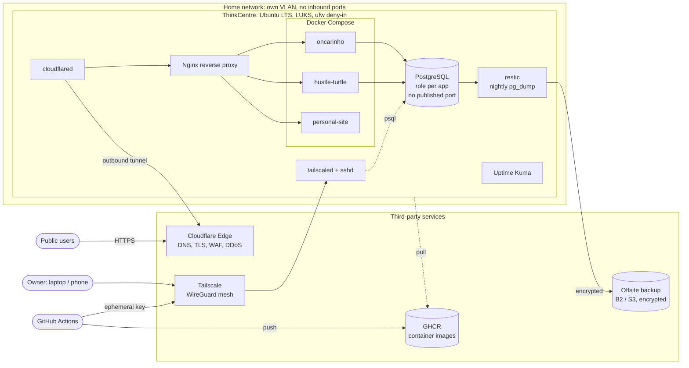

# Technical Design: Lonely Moley v1 (ThinkCentre Homelab)

> **Status**: Draft
> **Author**: To Ngoc Long
> **Date**: 2026-10-22
> **Last updated**: 2026-10-22
> **Spec**: [wiki/specs/lonely-moley.md](../specs/lonely-moley.md)

## Context

Movoz services run locally or on AWS today. A Lenovo ThinkCentre is available at home. We want to use it as a private cloud. It will host movoz services and their PostgreSQL database.

The box is on a home network. A mistake can expose the home network to the internet. Security is the main design driver for v1.

## Goals

- Serve public movoz apps from the ThinkCentre on our own domain.
- Keep all router ports closed. The home IP must not appear in DNS.
- Host PostgreSQL for the movoz backends. Only the apps and the owner can reach it.
- Deploy from GitHub Actions without a self-hosted runner.
- Keep an encrypted offsite backup of every database. Prove that a restore works.
- Get an alert when a service or the host goes down.

## Non-Goals

- High availability. One box is a single point of failure, and we accept this.
- Kubernetes in v1. We use Docker Compose first. k3s is a later phase.
- Removing the dependency on Cloudflare. v1 uses Cloudflare Tunnel. A later phase can replace it.
- Hosting services for other people.

## Proposed Solution

### Overview

Public traffic goes through Cloudflare. A `cloudflared` daemon on the box opens an outbound tunnel to Cloudflare. Nginx receives the traffic from the tunnel and routes it to the apps.

Private traffic goes through Tailscale. The owner and GitHub Actions use Tailscale to reach SSH and PostgreSQL. No service listens on the public internet.

### Detailed Design

#### Host

| Item | Choice | Reason |
|---|---|---|
| OS | Ubuntu Server LTS, minimal, no desktop | Long support, small attack surface |
| Disk | LUKS full-disk encryption, TPM2 auto-unlock (`systemd-cryptenroll`) | Protects data if the box is stolen. Boots without a person. |
| BIOS | Admin password, no USB boot, power on after AC loss | Stops boot tampering. Recovers after a power cut. |
| Patching | `unattended-upgrades` with an automatic reboot window | Security fixes arrive without manual work |
| Users | One admin user with `sudo`. One `deploy` user for CI. No root login. | Least privilege |
| Power | Small UPS | Protects PostgreSQL from corruption on power loss |

#### Network

- The router has no port forwards. Do not turn on UPnP.
- Put the box on its own VLAN or guest network. A compromised container must not reach other home devices.
- `ufw default deny incoming`. Allow inbound traffic on `tailscale0` only.
- **Docker bypasses ufw.** A published port such as `5432:5432` is open on every interface. Bind published ports to `127.0.0.1`, or do not publish them. Services talk over Docker networks.

#### Public ingress: Cloudflare Tunnel

- `cloudflared` runs as a container or a systemd service. It connects out to Cloudflare. It needs no inbound port.
- Each public hostname maps to the Nginx container, for example `movoz.dev → http://nginx:80`.
- Nginx keeps the current multi-zone routing from `infra/nginx/nginx.conf`.
- Admin tools (Uptime Kuma, database UIs) do not get a public hostname. If one must be public, protect it with Cloudflare Access.

#### Private access: Tailscale

- `sshd` listens on the Tailscale IP only. Key login only (`PasswordAuthentication no`, `PermitRootLogin no`).
- Use Tailscale ACLs. Tag the box `tag:server` and CI nodes `tag:ci`. Let `tag:ci` reach port 22 on `tag:server` only.
- The owner reaches PostgreSQL through Tailscale with an SSH tunnel or a `127.0.0.1` bind. PostgreSQL never listens on a public interface.

#### Services

- Run with Docker Compose. Start from `infra/docker-compose.yml`.
- Run each container as a non-root user. Pin each image to a version or digest.
- Do not mount `/var/run/docker.sock` into any container.
- Set `restart: unless-stopped` on every service.
- Keep secrets in `.env` files on the box with `chmod 600`. Do not commit them. Move to `sops` + `age` later if secrets need to live in git.

#### Database

- One PostgreSQL container on an internal Docker network.
- Use one database and one role per app (`hustle_turtle`, `oncarinho`). A role cannot read another app's database.
- Use `scram-sha-256` auth and long random passwords.
- Store data on a named volume on the encrypted disk.

#### Backups

- A nightly job runs `pg_dump` for each database.
- `restic` encrypts the dumps and sends them to Backblaze B2 or S3.
- Keep 7 daily, 4 weekly and 6 monthly snapshots.
- Do a restore test into a scratch database once a month. A backup that was never restored does not count.

#### Deploy

The movoz repo is public. A self-hosted GitHub runner on the box would let any pull request run code on the home network. We do not use one.

1. GitHub Actions builds the images and pushes them to GHCR.
2. The workflow joins the tailnet with `tailscale/github-action` and an ephemeral, `tag:ci` auth key.
3. The workflow uses SSH to connect as `deploy` and runs `docker compose pull && docker compose up -d`.
4. The `deploy` user can run only that command. Use a forced command in `authorized_keys`.

#### Monitoring

- Uptime Kuma checks each public URL and each internal service. It sends alerts to the phone.
- `smartmontools` watches disk health. An alert fires when the disk is more than 80% full.
- Tailscale admin shows if the box goes offline.

### Alternatives Considered

| Approach | Pros | Cons | Verdict |
|---|---|---|---|
| Cloudflare Tunnel | Free, no open ports, home IP hidden, TLS and DDoS protection included | Cloudflare terminates TLS and can see traffic. Vendor dependency. | Chosen for v1 |
| VPS + WireGuard tunnel (Caddy, Pangolin, frp) | No open ports, home IP hidden, full control, no TLS inspection by a third party | About €4 per month. One more server to harden. | Planned replacement for Cloudflare |
| Tailscale Funnel | Free, very easy | No custom domain. Bandwidth limits. | Use for quick tests only |
| Port-forward 443 to the box | Free, direct | Home IP public. No DDoS protection. Fails behind CGNAT. | Rejected |
| Self-hosted GitHub runner on the box | Simple deploys | Public repo lets pull requests run code at home | Rejected |
| k3s in v1 | Matches the long-term spec | More moving parts before the basics are safe | Deferred |

## Migration / Rollout Plan

Do the steps in this order. Do not expose a public service before steps 1 to 5 are done.

- [ ] **1. Install the OS.** Install Ubuntu Server LTS with LUKS. Set up TPM2 auto-unlock. Set the BIOS password, turn off USB boot, and set power on after AC loss.
- [ ] **2. Harden the host.** Create the admin user. Turn on `unattended-upgrades`. Set up the UPS.
- [ ] **3. Set up Tailscale and SSH.** Join the tailnet. Bind `sshd` to the Tailscale IP. Turn off password and root login. Write the ACLs.
- [ ] **4. Set up the firewall and network.** Set `ufw` to deny inbound traffic and allow `tailscale0`. Move the box to its own VLAN. Make sure the router has no port forwards.
- [ ] **5. Install Docker.** Install Docker Engine and Compose. Check that no published port binds to `0.0.0.0` (`ss -tlnp`).
- [ ] **6. Set up PostgreSQL and backups.** Create the databases and roles. Set up the nightly `pg_dump` + `restic` job. **Restore one backup into a scratch database.**
- [ ] **7. Deploy the services.** Start the apps and Nginx with Compose.
- [ ] **8. Set up Cloudflare Tunnel.** Move the domain DNS to Cloudflare. Start `cloudflared`. Publish one service first, then the rest.
- [ ] **9. Set up the CI deploy.** Create the `deploy` user with a forced command. Add the Tailscale and SSH secrets to GitHub. Add the deploy workflow.
- [ ] **10. Set up monitoring.** Install Uptime Kuma and `smartmontools`. Send a test alert.

### Verification

| Check | How |
|---|---|
| No open ports from the internet | Scan the home WAN IP from outside (for example `nmap` from a VPS or phone hotspot). Expect no open ports. |
| Home IP is not in DNS | `dig` each public hostname. Expect only Cloudflare IPs. |
| SSH is private | `ssh` to the LAN IP fails. `ssh` to the Tailscale IP works. Password login is refused. |
| PostgreSQL is private | `ss -tlnp` shows no `0.0.0.0:5432`. A connection from the LAN fails. |
| Docker did not bypass ufw | `ss -tlnp` shows every published port on `127.0.0.1` only. |
| Backups restore | A monthly restore into a scratch database succeeds, and row counts match. |
| Box recovers from power loss | Pull the power, plug it back in. The box boots, unlocks and serves traffic with no person present. |
| Alerts work | Stop one container. An alert arrives on the phone. |

## Dependencies

- A domain with its DNS on Cloudflare.
- A Tailscale account (the free tier is enough).
- A Backblaze B2 or S3 bucket for backups.
- GHCR images for each service. The services need Dockerfiles.

## Risks

| Risk | Likelihood | Impact | Mitigation |
|---|---|---|---|
| A Docker port is published on `0.0.0.0` and bypasses ufw | Med | High | Bind to `127.0.0.1`. Check with `ss -tlnp` after each change. |
| Data loss from disk failure | Med | High | Nightly offsite backups. Monthly restore test. SMART alerts. |
| A compromised container reaches home devices | Low | High | Separate VLAN. Non-root containers. No Docker socket mounts. |
| Cloudflare outage or account problem | Low | Med | VPS tunnel is the documented fallback. |
| Leaked CI secret gives access to the box | Low | High | Ephemeral Tailscale keys. ACL limits CI to port 22. `deploy` user has a forced command. |
| Power or ISP outage | Med | Low | UPS. Accept downtime for personal projects. |
